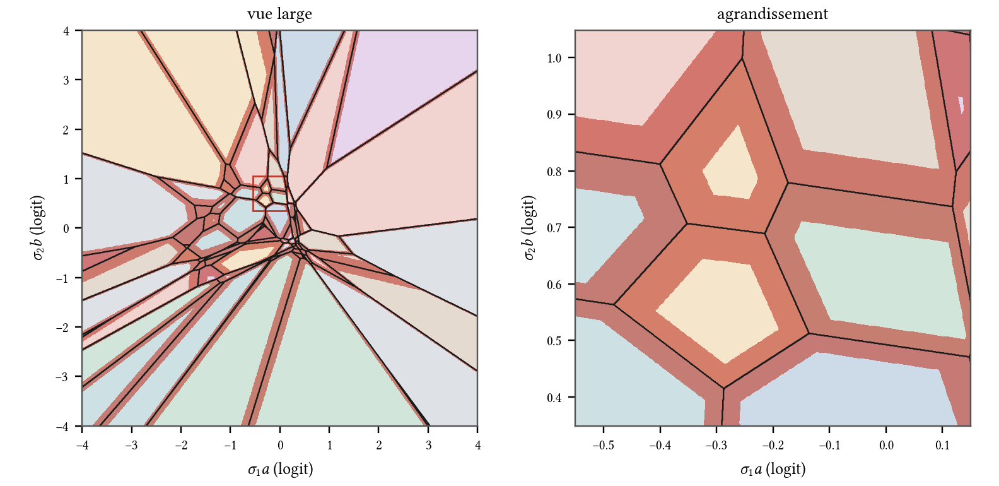

# La garde tropicale : jugée sur les journaux de routage du lot R

Piste 05 § 3.1 (idée de Stone, § 5 quinquies). Écrit le 2026-10-21 et le 2026-10-22, en parallèle des
lots A et B, sans la carte graphique. Seuil et protocole déclarés et commités avant toute lecture
(`seuil-declare.md`, commit `69260f1`). Chaque chiffre ci-dessous renvoie au fichier commité qui le
porte, sous `mesures/pistes/tropicale/` ; les outils sont sous `outils/pistes/tropicale/`.

Étiquettes : [mes.] mesuré ici ; [calc.] calculé ici à partir de mesures ; [mod.] tiré d'un modèle,
dit tel ; [litt.] littérature.

---

## 0. En bref

- **Verdict, au seuil déclaré : la garde tombe.** Au seuil τ₁₀ = 0,01241 qui signale 10 % des
  cellules (couche, position), elle attrape **57,1 % des bascules** (2 905 sur 5 087), loin des 80 %
  exigés. Le second chemin (lecture en Python pur du lot R, comptage par boucles) rend les mêmes
  2 905 bascules sur les mêmes 12 264 cellules [mes. ; `garde-resume.json`, `second-chemin.json`].
  La prédiction écrite avant la lecture disait 55 à 65 %.
- **Ce que coûterait 80 %** : τ = 0,0366, soit **26,6 % des cellules** [mes.]. Même l'oracle non
  déployable min(m_A, m_B) n'attrape que 65,7 % à 10 % [mes.].
- **Pourquoi** : la garde voit bien les premières couches (100 % à la couche 0, 86 à 91 % aux couches
  1 à 4) et mal les dernières (38 à 60 % des couches 8 à 23) [mes.]. La perturbation de l'écart
  4e − 5e logit grandit avec la profondeur, et surtout **les bascules s'enchaînent** : sachant une
  bascule à la couche ℓ, la même position bascule à ℓ + 1 dans 26,6 % des cas, contre 3,4 % sans
  (×7,9) [mes.] ; ces bascules secondaires tombent à des marges larges, que la garde ne peut pas voir.
- **Le nombre de garde** [calc. ; mod.] : si la marge est exponentielle de moyenne E[m] et la
  perturbation de l'écart gaussienne d'écart-type σ, la courbe de la garde ne dépend que de
  κ = σ / E[m], en forme close (§ 6.1, vérifiée par quadrature à ~~1,3·10⁻¹⁴~~ 3,7·10⁻¹⁵ près). Le critère 80 / 10
  demande **κ ≤ 0,108**, c'est-à-dire, **pour une population homogène**, ~~au plus 4,0 % de cellules
  qui basculent~~ (corrigé après le jugement du 2026-10-22 : la garde réelle mêle 24 couches de σ et
  de marge moyenne différents, et un contre-exemple construit tient 80 / 10 avec 5,26 % de bascules ;
  voir § 6.1). Les deux rampes en font 4,15 %. **Ce n'est pas l'explication de l'échec** : au taux mesuré
  le modèle homogène donne 78,8 % de bascules attrapées contre 57,1 % mesuré ; le nombre de garde rend
  compte d'environ 1 point sur les 23 qui manquent. Le reste vient de l'hétérogénéité des couches et
  des cascades (§ 4, § 5.4). Le mode rapide perturbe plus.
- **Exploration, après le verdict, qui ne le change pas** : la garde attrape **85,2 % des racines de
  cascade** (la première bascule de chaque position : 1 773 sur 2 081), second chemin égal à l'unité
  [mes. ; `cascades.json`, `second-chemin-racines.json`]. Si la réparation d'une racine éteint ses
  suites, c'est elle qu'il faut attraper. Le modèle à δ empirique la prédit à 85,3 % (mesuré 85,2 %)
  et la fait passer sous 80 % dès que la perturbation est **1,3 fois** plus forte que celle des deux
  rampes (~~1,4 fois~~ dans le message du commit `1e97be1` : l'interpolation linéaire entre s = 1 et
  s = 1,5 donne 1,33) [mod.].
- **Ce que 05 disait non mesuré, maintenant mesuré** : la marge suit une loi **presque exponentielle**
  à chaque couche (forme gamma 0,91 à 1,09 ; pente log-log 0,90 à 1,20 près de zéro), comme le prédit
  l'espacement des statistiques d'ordre ; les marges d'une couche à la suivante sont **presque
  indépendantes** (Spearman groupé 0,058) ; la loi de bascule a la forme **Φ(−m/σ)** (palier ½ quand
  m → 0 : 58 bascules sur 106 cellules sous 10⁻⁴), pas 2Φ ; comme priorité de préchargement, la marge
  **n'annonce pas** la couche suivante (aire ROC 0,567, sous la barre de 0,60) et annonce **faiblement**
  le jeton suivant (aire 0,627 ; 3,8 % d'ensembles identiques au décile bas contre 13,9 % au haut) [mes.].
- **La mémoire du conflit (§ 12, ajoutée le 2026-10-26, inspirée du cortex cingulaire)** : une garde qui
  lit, en plus de la marge, le conflit déjà vu plus bas sur la même position, celui de la position
  précédente et le conflit accumulé sur huit positions, attrape **58,6 %** des bascules pour 10 % des
  cellules contre 57,0 % pour la marge seule : **+1,61 point** (IC à 95 % 0,99 à 2,34 ; 9 fenêtres sur
  10), sous les 5 points déclarés. Tout le gain vient d'un indice, le conflit plus bas sur la même
  position ; la trace temporelle (position précédente, huit dernières positions) n'apporte rien
  [mes.].
- **Pas de cahier de construction.** À la place : la mesure qui jugerait la garde des racines sur le
  mode rapide, son seuil déclaré d'avance, et ce qu'elle coûte (§ 8).

---

## D'où on part, où on va

- **Acquis au départ** (05 § 2.2 et § 3.1 ; Tome II, lot R, § 2.9 et § 2.10) : les bascules de
  routage portent l'essentiel de la KL entre deux calculs proches (88 % retirés par le routage imposé ;
  96,5 % de la KL sur les positions qui basculent) ; la marge médiane vaut 0,083 sur toutes les
  cellules et 0,0095 sur celles qui basculent.
- **Établi ici** : la marge, prise seule, ne trie pas assez bien les bascules pour une garde à 10 %
  (57,1 %) ; elle trie bien les **racines** (85,2 %), et une seule grandeur sans dimension, κ, dit
  quand une garde à marge peut marcher. Les lois de la marge, de la bascule et de la propagation sont
  mesurées couche par couche.
- **Ce qui reste** : un journal de routage **du mode rapide** (experts compressés contre exacts) pour
  connaître son κ et juger la garde des racines ; la mesure de la **réparation** (refaire la couche ℓ
  en exact éteint-elle la racine et ses suites ?), que des journaux ne peuvent pas donner.

---

## 1. La question, et le seuil déclaré

Le routeur d'une couche calcule z = W_r h + b_r (32 logits) et garde les quatre plus grands. Les
régions où l'ensemble choisi est constant sont des polyèdres ; la marge m = z₍₄₎ − z₍₅₎ est la
distance de h à la frontière la plus proche, en logits (05 § 3.1). La garde : en mode rapide, après
les experts rapides de la couche ℓ, le moteur lit la marge du routeur de ℓ + 1 ; sous un seuil τ, il
refait la couche ℓ en exact pour cette position.

Le coût est la part des cellules signalées c(τ) ; le gain, la part des bascules signalées b(τ).
Seuil (05 § 3.1, déclaré et commité avant la lecture, `seuil-declare.md` § 3) : **la garde vaut d'être
construite si elle attrape au moins 80 % des bascules en signalant au plus 10 % des cellules.** Le
10 % dérive du coût : un défaut d'expert exact sur 10 % des cellules coûte au plus 10 % des octets du
mode exact.

La garde tourne dans le calcul rapide et ne voit que sa propre marge : la marge qui décide est celle
de **B** (la rampe de llama.cpp, le calcul qui s'écarte de la référence A dans le couple du juge).

*Figure T6. Les régions top-4 du routeur réel de la couche 12 de gpt-oss-20b, dans le plan des deux
premières directions singulières à droite de W_r (h = a u + b v, par l'origine de l'espace des états
normalisés) ; en rouge, la bande de garde {m < τ₁₀}. À gauche, 92 régions en 8 × 8 logits ; à
droite, l'agrandissement d'une grappe de petites régions (0,7 × 0,7 logit). La bande s'étend, de
chaque côté d'une frontière z_i = z_j, sur τ / ‖P(w_i − w_j)‖ (P, la projection sur le plan) : large
là où deux experts voisins se ressemblent dans le plan. Une coupe à deux dimensions d'un espace à
2 880 : la géométrie y est vraie, les aires ne sont pas des probabilités. Script : `figures.py`.*

---

## 2. Les données, et les témoins

**Données** (commitées par le lot R, commit `21453da` ; empreintes dans `seuil-declare.md` § 1) : trois
journaux de routage de gpt-oss-20b, 24 couches × 5 110 positions (10 fenêtres de 511), soit 122 640
cellules : A (`ref-openai-bis-20b.bin`), B (`ref-llamacpp-bis-20b.bin`), C (`ref-llamacpp-routage-
openai-20b.bin`, routage de A imposé). Ce sont les seuls journaux du dépôt et de
`~\dev\essais\troncons\` qui portent une marge (les `.npz` de l'épreuve J1 n'ont que les
experts) ; s'y ajoute, pour un contrôle croisé, K3 d1 (`mesures/moteur/K/k3/k3-chaine-d1-gptoss20b-
marges.csv` : moteur de la carte contre la référence, 3 840 cellules, marge de la référence).
**Aucun journal de routage du mode rapide n'existe.**

**Témoins** (`temoins.py` → `temoins.json`, tous tenus) [mes.] :

| Témoin | Réponse connue | Obtenu | Cassure | Elle tombe ? |
|---|---|---|---|---|
| T1, la lecture | le résumé commité de `bascules.py` : 5 087 bascules, 8 quantiles de marge | 5 087, les 8 quantiles au dernier chiffre de f32 | un octet d'expert changé (cellule 0, 0) | 5 088 : oui |
| | | | lecture au pas de 7 octets | refusée par la taille : oui |
| T2, la réponse d'avance | A contre C (routage imposé) : 0 bascule | 0 | un expert changé dans C (7, 1 000) | 1 : oui |
| T3, l'instrument discrimine | marges permutées : b(τ₁₀) = 10 % ± 2 | 10,05 % | — | — |
| | marges oracles (0 sur les bascules) : b = 100 % pour c ≤ 4,2 % | 100 % à 4,15 % | — | — |

T3 est sa propre cassure : le même instrument rend 10 % quand la marge ne sait rien et 100 % quand
elle sait tout. Aucune cellule n'a d'expert en double (l'ensemble trié vaut le `frozenset` du lot R).

---

## 3. Le verdict : la courbe de la garde

`garde.py` → `garde-resume.json`, `courbe-garde.csv` ; second chemin `second_chemin.py` →
`second-chemin.json` [mes.].

| τ | cellules sous τ | part des cellules c | bascules sous τ | part des bascules b |
|---|---|---|---|---|
| 10⁻⁴ | 106 | 0,09 % | 58 | 1,1 % |
| 3,16·10⁻⁴ | 336 | 0,27 % | 168 | 3,3 % |
| 10⁻³ | 995 | 0,81 % | 477 | 9,4 % |
| 3,16·10⁻³ | 3 238 | 2,64 % | 1 265 | 24,9 % |
| 10⁻² | 10 089 | 8,23 % | 2 654 | 52,2 % |
| **τ₁₀ = 0,012410** | **12 264** | **10,00 %** | **2 905** | **57,1 %** |
| 1,58·10⁻² | 15 406 | 12,56 % | 3 167 | 62,3 % |
| 3,16·10⁻² | 28 733 | 23,43 % | 3 932 | 77,3 % |
| 0,0366 (80 % des bascules) | — | 26,60 % | — | 80,0 % |
| 10⁻¹ | 69 090 | 56,34 % | 4 829 | 94,9 % |

**Second chemin** : τ₁₀ = 0,012409966439008713 ; 12 264 cellules ; 2 905 bascules ; égal à l'unité ;
verdict « tombe » par les deux chemins.

**Les variantes, qui ne décident pas** [mes.] :

| Marge de garde | b(τ₁₀) | c pour 80 % | Aire ROC |
|---|---|---|---|
| **B (décide)** | **57,1 %** | **26,6 %** | 0,862 |
| A | 56,1 % | 26,2 % | 0,862 |
| min(A, B), oracle non déployable | 65,7 % | 16,9 % | 0,912 |
| B, positions notées par le juge seules | 53,4 % | 30,0 % | 0,848 |
| K3 d1 (marge de la référence, 22 bascules) | 40,9 % (9 sur 22) | — | 0,777 |

K3 d1 ne juge rien (22 bascules : l'intervalle à 95 % de 9 sur 22 va de 21 à 64 %), mais il ne
contredit pas : sous une autre perturbation (le moteur de la carte contre la référence), la garde
rate aussi plus de la moitié des bascules, dont trois à des marges au-dessus de 0,12.

*Figure T1 (`\GrapheTropicaleCourbe`, `figures-tropicale.tex`) : la courbe (c, b) pour toutes les
bascules, les racines, les secondaires et l'oracle, avec la zone de construction déclarée.*

---

## 4. Par couche : la profondeur

`decile-par-couche.csv`, au τ₁₀ global [mes.] :

| Couches | taux de bascule | b(τ₁₀) | marge médiane aux bascules | aire ROC |
|---|---|---|---|---|
| 0 | 0,72 % | 100 % | 0,0013 | 0,991 |
| 1 à 4 | 1,3 à 1,9 % | 86,0 à 91,0 % | 0,0029 à 0,0045 | 0,956 à 0,961 |
| 5 à 7 | 2,1 à 3,1 % | 73,9 à 79,6 % | 0,0042 à 0,0060 | 0,930 à 0,957 |
| 8 à 14 | 3,3 à 5,0 % | 51,2 à 58,6 % | 0,0092 à 0,0113 | 0,851 à 0,896 |
| 15 à 23 | 4,7 à 8,1 % | 37,8 à 60,5 % | 0,0084 à 0,0199 | 0,771 à 0,864 |

L'échelle robuste de la perturbation de l'écart, δ = m_A − m_B sur les cellules sans bascule à grande
marge (m_B > 0,1), monte de 0,0022 (couche 0) à 0,0059–0,0086 (couches 9 à 23) [mes. ;
`loi-bascule-sigma.csv`]. Une garde réglée couche par couche (τ_ℓ appris sur cinq fenêtres, jugé sur
les cinq autres, puis l'inverse) ne gagne rien : 55,4 et 56,0 % contre 55,9 et 58,7 % pour le τ
global sur les mêmes moitiés [mes. ; `cascades.json`].

*Figure T2 (`\GrapheTropicaleCouches`) : b(τ₁₀) par couche (toutes, racines, secondaires) et
l'échelle de δ.*

---

## 5. Ce que 05 disait non mesuré

### 5.1 La loi de la marge, par couche

`lois.py` → `loi-marge-par-couche.csv` [mes.]. À chaque couche :

- l'ajustement **gamma** donne une forme de **0,91 à 1,09** (1 serait l'exponentielle) ; distance de
  Kolmogorov-Smirnov à l'exponentielle de même moyenne : 0,006 à 0,042 ; à la demi-normale : 0,09 à
  0,18 ; à la log-normale : 0,06 à 0,08 ;
- la pente de log P(m < τ) contre log τ, sur [10⁻⁴ ; 10⁻²], vaut **0,90 à 1,20** : la densité en zéro
  est finie et non nulle, et vaut à peu près 1 / E[m] (densité sous 10⁻³ : 5,5 à 17,6 ; 1 / E[m] :
  5,2 à 16,3) ;
- la médiane va de 0,041 (couche 23) à 0,127 (couche 21) ; les couches profondes ont des marges plus
  serrées (1 / E[m] : 6,2 à 8,3 aux couches 0 à 14, 9,5 à 16,3 aux couches 15 à 23, sauf la 21 : 5,2).

La raison [calc.] : l'espacement z₍₄₎ − z₍₅₎ entre deux statistiques d'ordre voisines du haut d'un
échantillon suit, quand l'échantillon est assez grand, une loi exponentielle (représentation de
Rényi : pour des variables exponentielles indépendantes, l'espacement de rang k est exponentiel de
taux k fois le taux de la loi mère ; pour une loi mère de taux de défaillance h, l'espacement de rang
4 est à peu près exponentiel de taux 4 h(z₍₄₎)) [litt. : A. Rényi, « On the theory of order
statistics », *Acta Math. Acad. Sci. Hungar.* 4 (1953), 191–231, doi:10.1007/BF02127580,
https://link.springer.com/doi/10.1007/BF02127580 ; notice bibliographique vérifiée le 2026-10-22,
article lui-même non relu dans ce rôle]. Les 32 logits ne sont pas indépendants ;
la mesure dit que la conclusion tient quand même.

*Figure T3 (`\GrapheTropicaleSurvie`) : la survie P(m > x) en échelle logarithmique, quatre couches,
et l'exponentielle de même moyenne en tirets.*

### 5.2 La corrélation des marges d'une couche à la suivante

`correlation-couches.csv` [mes.]. Pour une même position, la corrélation de Spearman entre m_ℓ et
m_{ℓ+1} va de 0,002 à 0,125 selon le couple de couches ; groupée sur les 23 couples, **0,058**, au-dessus
du 99,9e centile de 999 permutations (0,023) : réelle et minuscule. Le levier
P(m_{ℓ+1} < τ₁₀ | m_ℓ < τ₁₀) / P(m_{ℓ+1} < τ₁₀) va de 0,68 à 1,28. **Une marge serrée à une couche ne
dit presque rien de la suivante** : chaque couche tire sa marge à neuf.

### 5.3 La loi de bascule

`loi-bascule-classes.csv`, `loi-bascule-sigma.csv` [mes.]. Si la marge de B est m et que la
perturbation de l'écart entre A et B est δ, la cellule bascule quand δ < −m (l'écart de A passe sous
zéro). Pour δ symétrique, P(bascule | m) = P(δ < −m) → ½ quand m → 0. Le modèle déclaré dans
`seuil-declare.md` § 5, 2Φ(−m/σ), vaudrait 1 en zéro ; la dérivation donne Φ(−m/σ). Les données
tranchent : sous m = 10⁻⁴, **58 bascules sur 106 cellules (0,55 ± 0,05)** ; la vraisemblance de Φ bat
celle de 2Φ aux 24 couches. La forme gaussienne elle-même est fausse dans la queue : δ a un kurtosis
en excès de 3,5 (couche 0) à 134 (couche 7). Le modèle gaussien prédit 7,8 % de bascules (mesuré
4,15 %) ; la forme empirique de δ, mise à l'échelle, en prédit 3,6 % [calc. ; `extrapolation-garde.csv`].

*Figure T4 (`\GrapheTropicaleLoiBascule`) : P(bascule | m) mesurée par classes, trois groupes de
couches, avec le modèle à δ empirique (trait plein) et le gaussien (pointillés).*

### 5.4 La propagation : la probabilité de bascule à ℓ + 1 sachant ℓ

`propagation.csv` [mes.]. Sachant une bascule en (ℓ, p), la même position bascule en ℓ + 1 dans
**26,6 %** des cas (4 672 couples), contre **3,4 %** sans bascule en ℓ. Par classe de marge à ℓ + 1 :

| marge en ℓ + 1 | P(bascule) après une bascule | sans bascule avant | rapport |
|---|---|---|---|
| < 10⁻³ | 61,8 % (34) | 47,5 % (930) | 1,3 |
| 10⁻³ à 10⁻² | 57,1 % (380) | 23,1 % (8 403) | 2,5 |
| 10⁻² à 3·10⁻² | 47,2 % (755) | 5,4 % (15 896) | 8,7 |
| 3·10⁻² à 0,1 | 27,0 % (1 716) | 1,3 % (38 415) | 21 |
| > 0,1 | 10,5 % (1 787) | 0,14 % (49 214) | 75 |

Après une bascule, l'état caché a changé d'experts : la perturbation n'est plus un arrondi, c'est la
différence entre deux experts (05 § 2.2 : 33 à 84 % de l'énergie de sortie). Elle fait basculer des
cellules à marge large, que la garde ne signale pas. C'est la cause principale de la chute en
profondeur : les secondaires sont 59 % des bascules (3 006 sur 5 087), leur marge médiane vaut 0,0194
contre 0,0037 pour les racines.

### 5.5 La marge comme priorité de préchargement

`lois-resume.json` § prechargement, `prechargement-jeton-suivant.csv` [mes.]. Barre déclarée : aire
ROC > 0,60 et au-dessus du 99,9e centile de 999 permutations.

- **P1, la couche suivante** (la marge en ℓ annonce-t-elle une bascule en ℓ + 1, même position ?) :
  aire **0,567** (permutations : 0,512). Au-dessus du hasard, **sous la barre : pas une priorité
  utile.** Pour comparaison, la marge de la couche elle-même fait 0,861. C'est la conséquence directe
  du § 5.2.
- **P2, le jeton suivant** (la marge de (ℓ, p) annonce-t-elle que p + 1 garde le même ensemble à la
  couche ℓ, dans le calcul B ?) : aire **0,627** (permutations : 0,512) : **priorité utile par la
  barre, mais faible**. Le jeton suivant garde l'ensemble entier dans 6,6 % des cas (3,8 % au décile
  de marge le plus bas, 13,9 % au plus haut) ; il garde en moyenne **2,0 experts sur 4** (1,89 au décile
  bas, 2,17 au haut ; le hasard en garderait 4 × 4 / 32 = 0,5). La localité d'un jeton au suivant
  est forte ; la marge ne l'explique qu'à la marge (Spearman 0,076).
- La lecture « routeur de ℓ + 1 appliqué à l'état de la couche ℓ » (la prédiction de préchargement
  des systèmes à pré-routage) demande les états cachés, qui ne sont pas journalisés : **non faite**.

---

## 6. Pourquoi elle tombe : le nombre de garde

### 6.1 La forme close

Hypothèses [mod.] : la marge M est exponentielle de taux λ (§ 5.1 : vrai à quelques points de KS près) ;
la cellule bascule si δ < −M, δ ~ N(0, σ²) indépendante de M (§ 5.3 : vrai au centre, faux dans la
queue). Avec κ = λσ = σ / E[M], t = τ/σ, Φ et φ la répartition et la densité normales :

- part des cellules : c(τ) = 1 − e^{−λτ} ;
- taux de bascule : P(B) = ∫₀^∞ λe^{−λm} Φ(−m/σ) dm. Par parties,
  P(B) = ½ − ∫₀^∞ e^{−λm} φ(m/σ)/σ dm, et e^{−κu} φ(u) = e^{κ²/2} φ(u + κ) donne
  **P(B) = ½ − e^{κ²/2} Φ(−κ)** ;
- bascules sous τ : ∫₀^τ λe^{−λm} Φ(−m/σ) dm = ½ − e^{−λτ} Φ(−t) − e^{κ²/2} [Φ(t + κ) − Φ(κ)] ;
- d'où **b(τ) = [½ − e^{−λτ} Φ(−t) − e^{κ²/2} (Φ(t + κ) − Φ(κ))] / P(B)**, avec λτ = −ln(1 − c).

La courbe (c, b) ne dépend que de κ. Second chemin : la quadrature numérique rend la même valeur à
**~~1,3·10⁻¹⁴~~ 3,7·10⁻¹⁵** près sur 18 couples (κ, c) (le premier chiffre venait de l’écriture naïve e^{κ²/2} Φ(−κ), qui perd des chiffres quand κ grandit ; réécrite par le logarithme de la queue normale, elle supprime aussi une petite remontée parasite de b vers κ = 10) [calc. ; `theoreme.json`]. Le seuil 80 / 10 se résout en
**κ\* = 0,1079**, où **P(B) = 4,03 %** [calc.].

**Corollaire** [mod.], ~~« une garde à marge ne peut tenir 80 / 10 que si le calcul rapide fait
basculer moins d'environ 4 % des cellules »~~ **corrigé par le jugement indépendant** (`JUGEMENT.md`
§ 4.1, `juge_modele.py`) : puisque b décroît et P(B) croît avec κ, **dans le modèle homogène** (une loi
de marge exponentielle, un seul σ), la garde tient 80 / 10 si et seulement si moins d'environ 4,0 %
des cellules basculent. La garde réelle applique un seuil global à 24 couches dont la marge moyenne va
de 0,061 à 0,193 et dont κ_ℓ va de 0,016 à 0,48 ; contre-exemple construit (2 couches sur 24 à marges
serrées, 22 à marges larges) : **P(B) = 5,26 % et pourtant b = 85,9 % pour 10 % des cellules**. Le
plafond de 4 % est donc une propriété du modèle homogène, pas de toute garde à marge. La phrase
~~« une queue de δ plus lourde ne fait que baisser ce plafond »~~ n'est vraie que dans le seul cas
calculé (δ empirique contre gaussien à taux égal) ; l'ordre « plus lourde » n'est pas défini, rien
n'est prouvé en général. **Le nombre de garde n'explique pas l'échec mesuré** : au taux mesuré de
4,148 % (5 087 / 122 640), le modèle homogène donne κ = 0,1113 et b = 78,8 %, la mesure 57,1 %.

Couche par couche (`theoreme-par-couche.csv`), κ_ℓ du maximum de vraisemblance de Φ va de 0,016
(couche 0) à 0,48 (couche 22) ; la forme close suit la mesure de b aux couches 0 à 9 à 0,1 près et la
sous-estime de 0,02 à 0,17 plus profond (le σ ajusté absorbe les secondaires).

### 6.2 L'extrapolation au mode rapide

`extrapolation-garde.csv`, `cascades.json` [mod.]. La perturbation de l'écart multipliée par s (s = 1 :
les deux rampes), la garde au même τ₁₀ :

| s | b(τ₁₀), toutes, δ gaussien | toutes, δ empirique | racines, δ empirique |
|---|---|---|---|
| 0,5 | 71,4 % | 74,5 % | 93,8 % |
| **1 (mesuré : 57,1 % ; racines 85,2 %)** | 49,0 % | 62,1 % | 85,3 % |
| 1,5 | 38,4 % | 54,9 % | 77,2 % |
| 2 | 32,4 % | 49,8 % | 69,9 % |
| 3 | 25,9 % | 42,5 % | 58,7 % |
| 5 | 20,2 % | 34,2 % | 45,1 % |
| 10 | 15,5 % | 25,3 % | 30,8 % |

À s = 1, les deux modèles encadrent la mesure pour toutes les bascules (49 et 62 % contre 57,1 %) ; pour
les racines, le modèle empirique tombe juste (1 956 racines prédites contre 2 081 comptées, b 85,3 %
contre 85,2 %). La perturbation du mode rapide n'est pas mesurée en marges ; ce qu'on sait de lui :
avec 32 experts sur 768 remplacés, sa KL est déjà 0,036 (05 § 1.2, P1) contre 0,0145 pour les deux
rampes (lot R § 2.9), et la KL monte avec le nombre d'experts remplacés (P3, 128 experts : 0,0636).
**Tout indique s > 1 pour le mode rapide entier**, donc une garde des racines sous 80 % aussi ; un
journal le dirait (§ 8).

*Figure T5 (`\GrapheTropicaleExtrapolation`).*

---

## 7. L'exploration après le verdict : la garde des racines

Étiquetée telle : cette lecture a été choisie **après** avoir vu la propagation ; elle ne change pas le
verdict déclaré. Elle n'a cependant aucun paramètre ajusté sur les bascules : τ₁₀ est un quantile
des marges seules, et la définition (première bascule de la position, toutes couches confondues) ne
dépend d'aucun seuil.

`cascades.py` → `cascades.json`, `cascades-par-couche.csv` ; second chemin
`second_chemin_racines.py` → `second-chemin-racines.json` [mes.] :

- 2 081 positions sur 5 110 (40,7 %) ont au moins une bascule ; leur première bascule (la racine) est
  signalée dans **85,2 %** des cas (1 773) ; les secondaires, dans 37,7 % (1 132 sur 3 006). Second
  chemin égal à l'unité.
- par couche, les racines sont attrapées de 68 % (couche 20) à 100 % (couche 0), au-dessus de 80 % à
  17 couches sur 24 (sous 80 % : couches 9 à 13, 20 et 21).

Ce que ce chiffre vaudrait, si la réparation d'une racine éteignait ses suites [calc. sur hyp.] : les
positions dont la racine échappe (14,8 % des 2 081) garderaient leur cascade ; les autres n'en
auraient plus. Mais deux choses manquent, et aucun journal ne les donne :
1. **La réparation.** Dans ces journaux, la perturbation vient de la rampe de position (l'attention),
   pas des experts : refaire une couche en exact n'y changerait rien. En mode rapide, refaire la
   couche ℓ en exact retire l'erreur des experts de ℓ, pas celle des couches d'avant ni celle du cache
   KV des positions passées ; que la racine ne bascule plus n'est pas acquis.
2. **Le κ du mode rapide** (§ 6.2).

---

## 8. Le verdict, et ce qui le remplace : la mesure suivante

**Verdict, au seuil déclaré : la garde tropicale tombe** (57,1 % des bascules pour 10 % des
cellules ; 80 % coûterait 26,6 %). **Pas de cahier de construction.**

Ce qui pourrait la relever est la garde des racines, et elle se juge en une passe, sur la carte, quand
la carte est libre (l'affaire du flux qui la tient) :

**G2, la garde des racines sur le mode rapide** (seuil à déclarer et commiter avant la passe ; voici sa
forme, dérivée du coût comme le premier) :
- *Données* : deux journaux au format du lot R (24 × 5 110 cellules, mêmes 10 fenêtres), le moteur
  exact et le moteur en mode rapide (le compagnon du lot B), chacun avec sa propre marge. Coût du
  journal : 8 octets par cellule, 981 128 octets par passe. Le noyau `routeur_topk`
  (`moteur/crates/trc-noyaux`, appelé depuis `moteur/crates/trc-modele/src/lib.rs`, lignes 514, 565
  et 671 à ce jour) calcule déjà le classement : la marge z₍₄₎ − z₍₅₎ est une soustraction de plus et
  4 octets par cellule. Ces fichiers sont ceux des lots A et B : cette piste n'y touche pas.
- *Seuil* : la garde des racines vaut d'être construite si, au τ₁₀ des marges du mode rapide, elle
  signale au moins 80 % des racines en signalant au plus 10 % des cellules **et** si P(B) du mode
  rapide est mesuré, pour situer son κ. Prédiction écrite dès maintenant, **à lire comme celle du modèle homogène** (le jugement
  a montré qu'un mode rapide dont les bascules se concentrent dans des couches à marges serrées peut la
  démentir) : elle tombe si P(B) dépasse
  environ 5 % (à s ≈ 1,3, où les racines passent sous 80 % au § 6.2, le modèle empirique prédit
  4,6 % de bascules, 5,3 % une fois recalé sur les 4,15 % mesurés à s = 1).
- *Puis, seulement si G2 passe*, **G3, la réparation** : une passe où, à chaque racine signalée, la
  couche précédente est refaite en exact ; mesure : KL contre le mode exact, appariée contre le mode
  rapide sans garde, et part des cellules refaites (règle du lot R : meilleur si d̄ + 2σ(d̄) < 0).
  C'est seulement là qu'un cahier de construction aurait un objet : où (après `routeur_topk` de la
  couche ℓ + 1, avant la combinaison des experts de ℓ + 1), combien d'octets (au plus 10 % des
  octets du mode exact, plus 4 octets par cellule de marge), et le critère (la KL).

---

## 9. Ce qui pourrait être faux

- **La perturbation n'est pas celle du mode rapide.** Tout est mesuré sur l'écart entre deux calculs
  exacts (deux rampes de position). Le verdict « tombe » se transporte au mode rapide par le
  corollaire du § 6.1 et par l'extrapolation du § 6.2, qui sont des modèles ; un mode rapide dont
  l'erreur serait concentrée aux couches où la garde voit bien (0 à 4) ferait mieux que le modèle.
- **Une seule source de bascules.** La rampe touche l'attention à toutes les couches ; l'erreur des
  experts compressés n'est pas répartie pareil (la ronde a remplacé des experts de 4 couches
  seulement).
- **Le τ₁₀ global.** Une garde qui aurait d'autres entrées que la marge (l'écart 3e − 5e, la norme de
  l'état, le passé de la position) pourrait trier mieux ; ~~seule la marge est journalisée~~ (corrigé : les indices qu'on peut tirer de
  la marge de B seule, conflit plus bas sur la même position, conflit de la position précédente,
  conflit accumulé, sont mesurés au § 12 : +1,6 point, pas plus). La garde couche par couche, elle, est
  mesurée et ne gagne rien (§ 4).
- **Les racines sont une lecture choisie après coup** (§ 7) : 85,2 % n'est pas un verdict. La
  définition « première bascule de la position » ignore la propagation par le cache KV : une racine
  peut être la suite d'une bascule d'une position antérieure (lot R : à partir de la position 256,
  il y a toujours eu une bascule plus tôt dans la fenêtre).
- **La causalité des cascades** n'est pas prouvée par intervention ici : le rapport ×7,9 (et ×75 à
  marge large) est une association. L'intervention du lot R (routage imposé, 88 % de la KL retirée)
  va dans le même sens sans la démontrer pour les cascades.
- **Les modèles de δ.** Le gaussien est faux dans la queue (kurtosis jusqu'à 134) ; l'empirique est
  pris sur les cellules à grande marge sans bascule, où il peut sous-estimer la perturbation des
  cellules serrées. À s = 1, ils encadrent la mesure ; au-delà, ce sont des extrapolations.
- **La loi de Rényi** est citée d'après sa notice vérifiée, sans relecture de l'article (§ 5.1) : la
  mesure tient seule ; la forme exacte du théorème est à relire avant le mémoire.
- **La coupe du routeur** (figure T6) passe par l'origine de l'espace des états normalisés, pas par
  des états réels ; ses aires ne sont pas des fréquences. Le cadrage de l'agrandissement est un choix.
- **Les positions notées** (seconde moitié des fenêtres) donnent 53,4 % au lieu de 57,1 % : la
  conclusion ne change pas, le chiffre principal porte sur toutes les cellules, comme déclaré.

---

## 10. Recettes (pour RECETTES.md)

- **Témoin par réponse connue d'avance** : le routage imposé (A contre C) doit donner 0 bascule ; une
  cassure d'un octet en donne 1. Gratuit, et il prouve à la fois la lecture et la comparaison.
- **Témoin de discrimination** : marges permutées (le hasard, 10 %) et marges oracles (100 %) encadrent
  l'instrument ; un chiffre entre les deux veut dire quelque chose.
- **Second chemin par le code d'un autre** : relire les journaux avec la fonction `lire` du lot R
  (Python pur), pas avec une copie de la sienne.
- **La forme close avant le modèle numérique** : marge exponentielle et perturbation gaussienne donnent
  b(c ; κ) en fonctions de Φ ; la quadrature la vérifie à 4·10⁻¹⁵ (écrire e^{κ²/2} Φ(−κ) par le logarithme de la queue, sinon b remonte faussement pour κ grand) ; une seule grandeur (κ) remplace
  vingt-quatre ajustements.
- **Ce qui a échoué** : la garde réglée couche par couche (validée de façon croisée, aucun gain) ; le
  modèle gaussien de δ pour prédire le taux de bascule (×1,9) ; le modèle 2Φ déclaré (la dérivation
  donne Φ, les données aussi).
- **Un modèle à une seule entrée n'a pas de cassure par étiquettes mélangées** : son classement est
  ±marge quel que soit l'ajustement (50,6 % au lieu des 10 % attendus). La bonne cassure permute les
  entrées du test (9,97 %). Un attendu de témoin se dérive avant de se déclarer, comme un seuil.
- **Un témoin « oracle » se chiffre d'avance** : l'indice « bascule vérifiée à la couche d'avant » ne
  concerne que 3,8 % des cellules (24,5 % des bascules) ; son plafond est ~11 points, pas les 15
  déclarés. Calculer la part des cellules et des bascules que l'oracle touche avant de fixer la barre.
- **Une analogie du vivant se découpe** : la mémoire du conflit en profondeur (f2) a donné +1,6, celle
  dans le temps (f3, f4) rien ; l'ablation d'un indice à la fois dit quelle moitié de l'analogie
  porte la mesure.
- **Cohabitation** : `python -I` ne voit pas `psutil` (paquet de l'utilisateur) ; la priorité se baisse
  par `SetPriorityClass` en déclarant la pseudo-poignée en `c_void_p` (sinon l'appel échoue sans bruit
  sur 64 bits) ; la pause sur le verrou de la carte a tenu une génération de figures pendant une séance
  J1 du lot A.

---

## 11. Les fichiers

| Rôle | Fichier |
|---|---|
| seuil et protocole, déclarés avant | `genome/pistes/tropicale/seuil-declare.md` |
| lecture, cohabitation | `outils/pistes/tropicale/routage.py` |
| témoins T1 à T3 | `outils/pistes/tropicale/temoins.py` → `mesures/pistes/tropicale/temoins.json` |
| la courbe, le verdict | `garde.py` → `garde-resume.json`, `courbe-garde.csv`, `courbe-garde-par-couche.csv`, `decile-par-couche.csv` |
| second chemin du verdict | `second_chemin.py` → `second-chemin.json` |
| lois, corrélation, propagation, préchargement, extrapolation | `lois.py` → `lois-resume.json` et ses CSV |
| cascades (exploration) et son second chemin | `cascades.py`, `second_chemin_racines.py` |
| le nombre de garde | `theoreme.py` → `theoreme.json`, `theoreme-kappa.csv`, `theoreme-par-couche.csv` |
| figures (données et coupe) | `figures.py` → `mesures/pistes/tropicale/figures/` ; macros `genome/pistes/tropicale/figures-tropicale.tex` |
| garde à indices multiples (§ 12) : seuil déclaré avant | `genome/pistes/tropicale/seuil-declare-indices.md` |
| garde à indices multiples : mesure, second chemin, compléments | `indices.py`, `second_chemin_indices.py`, `indices_complements.py` → `mesures/pistes/tropicale/indices/` (`indices-resume.json`, `second-chemin-indices.json`, `complements.json`, `scores-M3.csv`) |
| pour le mémoire | `genome/pistes/tropicale/pour-le-memoire.md` |
| reprise | `genome/pistes/tropicale/REPRISE.md` |

---

## 12. La garde à indices multiples : la mémoire du conflit (2026-10-26)

Seuil, indices, modèles et témoins déclarés et commités avant tout calcul (`seuil-declare-indices.md`,
commit `50bf472`). Outils : `indices.py` (chemin principal), `second_chemin_indices.py` (Python pur),
`indices_complements.py` (après le verdict, exploratoire). Journaux : `mesures/pistes/tropicale/indices/`.

**D'où l'idée** [litt.]. Le cortex cingulaire antérieur surveille le conflit entre réponses concurrentes
et en accumule la trace d'un essai à l'autre (Botvinick, Braver, Barch, Carter, Cohen, *Psychological
Review* 108 (3), 2001, p. 624-652) ; sous conflit élevé, le cortex médiofrontal relève le seuil de
décision avant d'agir (Cavanagh, Wiecki, Cohen, Figueroa, Samanta, Sherman, Frank, *Nature
Neuroscience* 14 (11), 2011, p. 1462-1467, doi 10.1038/nn.2925) ; notices vérifiées le 2026-10-26, les
articles eux-mêmes non relus ici. La garde de ce document fait la moitié de ce mécanisme (elle lit le
conflit instantané, la marge). La mesure demande si la mémoire du conflit, l'autre moitié, trie mieux
les bascules. C'est une analogie qui propose une mesure ; elle ne prouve rien.

**Le protocole** [mes.]. Cinq indices tirés de la seule marge de B (jamais de A) : f1 = ln marge ;
f2 = ln de la plus petite marge des couches plus basses, même position ; f3 = ln marge de la position
précédente, même couche ; f4 = part des cellules (couches ≤ ℓ, huit dernières positions) sous
0,01241 ; f5 = profondeur. Régression logistique, dix plis (une fenêtre de test chacun), la garde
signale les 1 226 cellules de plus fort score de la fenêtre de test (10 %). Seuil déclaré : utile si
gain ≥ 5 points sur la marge seule, IC à 95 % (10 000 tirages des dix fenêtres) excluant 0, et positif
dans 8 fenêtres sur 10 ; seuil du 05 inchangé (80 % pour 10 %). Prédiction écrite : +1 à +6 points,
ne passe pas 80 %.

| Modèle | bascules attrapées pour 10 % des cellules | gain sur la marge seule | IC à 95 % | fenêtres positives |
|---|---|---|---|---|
| M0, la marge seule (la garde du § 3, par fenêtre) | 56,99 % | n/a | n/a | n/a |
| M1, f1 seul | 56,99 % (identique à M0 pli par pli) | 0 | n/a | n/a |
| M2, profondeur seule (f1, f5, f1·f5) | 57,26 % | +0,28 | −0,74 à +1,17 | 6 / 10 |
| **M3, tous les indices** | **58,60 %** | **+1,61** | **+0,99 à +2,34** | **9 / 10** |

**Verdict au seuil déclaré** : le gain est réel (l'IC exclut 0, 9 fenêtres sur 10) mais **sous les
5 points : la mémoire du conflit n'est pas utile**, et la garde reste très loin de 80 %. La prédiction
(+1 à +6) tient, celle de l'échec aussi [mes.].

**Second chemin** [mes.] : (a) recomptage en Python pur par classement explicite des scores écrits en
CSV : les attrapées de M3 et de M0 sont **égales à l'unité dans les dix plis** ; (b) autre classe de
modèle (probabilités par classes, sans régression) : 59,05 %, gain +2,06 points, positif dans 10
fenêtres sur 10, du même côté du seuil et à 0,45 point de la logistique (barre déclarée : 3 points).

**Les témoins** [mes.] :

| Témoin | Attendu déclaré | Obtenu | Tient ? |
|---|---|---|---|
| W1, identité M1 = M0 | égalité à l'unité | égalité dans les 10 plis | oui |
| W1, cassure : M1 entraîné sur étiquettes mélangées | 10 ± 2 % | ~~50,6 %~~ | **non, l'attendu était faux** : un modèle à une seule entrée classe les cellules par ±marge quel que soit l'ajustement, seul le signe du coefficient change. La cassure refaite par les marges de test permutées rend **9,97 %** (ajoutée après coup, hors de la déclaration, dite) |
| W2, f2 f3 f4 permutés dans chaque couche | gain dans ± 1,5 | +0,33 | oui |
| W3, f2 remplacé par « bascule vérifiée en (ℓ−1, p) » (fuite voulue) | gain > 15 points | +10,99 (par classes : +8,20) | **non, l'attendu était trop haut** : cet indice n'existe que pour 3,8 % des cellules et ne contient que 24,5 % des bascules ; même connu à coup sûr il ne porte que ~11 points. Il prouve néanmoins que l'instrument voit un indice de 11 points : celui de 1,6 n'est pas invisible |
| W4, M3 sur étiquettes mélangées | 10 ± 2 % | 11,6 % | oui |

Deux attendus déclarés faux sur cinq : le premier par une erreur de raisonnement sur ce que fait un
modèle à une entrée, le second par un ordre de grandeur non calculé. Ni l'un ni l'autre ne touche le
verdict, qui repose sur le gain, son IC, le second chemin et les témoins W1 (identité), W2 et W4.

**D'où vient le gain** [mes. ; exploratoire, après le verdict ; `complements.json`] :

| Modèle | gain | IC à 95 % | fenêtres positives |
|---|---|---|---|
| f1, f5 + f2 | +1,65 | +0,77 à +2,60 | 8 |
| f1, f5 + f3 | +0,33 | −0,69 à +1,25 | 6 |
| f1, f5 + f4 | +0,45 | −0,58 à +1,43 | 6 |
| M3 sans f2 | +0,43 | −0,59 à +1,38 | 6 |
| M3 sans f3 | +1,59 | +0,95 à +2,36 | 9 |
| M3 sans f4 | +1,61 | +0,70 à +2,60 | 8 |

**Tout le gain est f2**, le conflit déjà vu plus bas sur la même position (coefficient −0,46 en
échantillon : une petite plus petite marge plus bas annonce une bascule plus haut ; Spearman avec la
bascule −0,105, contre −0,250 pour la marge instantanée). La trace dans le temps, la partie la plus
proche du conflit accumulé du cortex (f3, f4), **n'apporte rien** dans ces journaux : Spearman −0,029 et
+0,025, coefficients proches de 0. L'analogie tient donc à moitié : la mémoire du conflit le long de
la **profondeur** (couches) aide un peu, celle le long du **temps** (positions) non, à cette
perturbation (deux rampes) et avec ces indices.

**Ce que cela fixe pour la garde** [calc.] : même un indice parfaitement fiable sur une bascule
antérieure ne vaut qu'environ 11 points ; le plafond d'une garde qui juge **cellule par cellule** est
bas. Ce qui reste est ce que le § 7 et le § 8 disaient : viser les racines des cascades (85,2 % à
10 %), et le mesurer sur le mode rapide (G2).

**Ce qui pourrait être faux ici** : les indices sont linéaires dans le logit (la logistique) ou en
classes grossières ; une forme plus riche (arbres, réseau) pourrait en tirer davantage, mais l'autre
classe de modèle ne gagne que 0,45 point de plus, et l'oracle plafonne bas. La perturbation est celle de
deux rampes exactes (§ 9). Les huit positions de f4 et son seuil sont des choix a priori, non balayés.
Le test porte sur dix fenêtres d'un même texte : l'IC dit la variation entre fenêtres, pas entre textes.
Les coefficients et les ablations sont lus en échantillon ou après le verdict : ils décrivent, ils ne
jugent pas.
